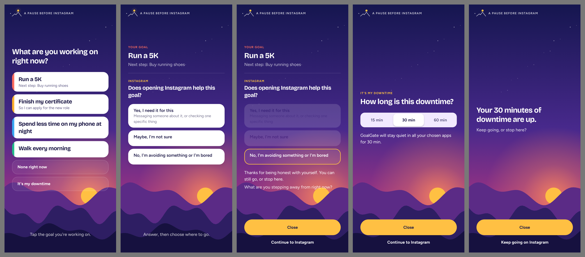
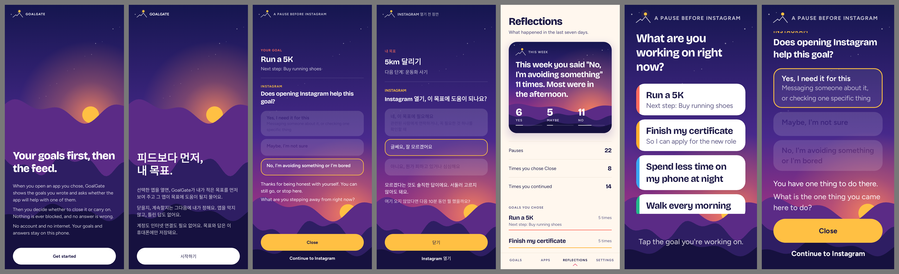

# GoalGate

An Android app that shows you your own goals before you open a distracting
app, and asks one honest question: will this help, or is it a way to avoid
something? Then the choice is yours. Nothing is blocked, nothing is scored,
and nothing leaves the phone.




The look is "sunrise on the trail": a dawn sky with mountain ridges and a
rising sun on the pause, warm paper elsewhere, and one bright colour per goal
(design rules at the top of `ui/theme/Theme.kt`).

GoalGate is built on WordGate's foundation (detection, permissions,
onboarding, cooldown, time check, escalation, widget, Korean support).

## Build and install

```
./gradlew installDebug     # build and install on a phone with USB debugging on
./gradlew test             # run the unit tests and the database update test
```

Needs JDK 17 or newer and Android SDK platform 35. Works on Android 8.0+.
Debug builds are signed with the committed key `app/debug.keystore`, so a new
APK installs over the old one as an update and keeps the user's data.

## The pause, step by step

1. **Your goals.** The goals you wrote, as cards. Tap the one you are working
   on, or "None right now". (With no goals left, this step is skipped.)
2. **The question.** Your goal on its own, exactly as you typed it; the app's
   name as a label; and one fixed question: *Does opening Instagram help this
   goal?* Answers: Yes, I need it for this / Maybe, I'm not sure / No, I'm
   avoiding something or I'm bored. The goal is never put inside the
   question, so any wording works, in English or Korean.
3. **The choice.** A short sentence that fits the answer (Settings > Tone:
   Gentle or Direct) and one of 40 original reflection lines. Then **Close**
   (the solid orange button) or **Continue** (quiet). From the 3rd open of the
   same app within an hour, Continue waits 5 seconds (10 from the 5th).

Every pause writes one row to the log: app, time, delay, engine, reason
(open or time check), the goal picked, the answer, the line shown, and the
action (Close, Continue, or none).

## Downtime, workday goals and steps

- **"It's my downtime"** is on the first step of every pause. Choose 15, 30
  or 60 minutes; Continue opens the app with no wait, and GoalGate leaves
  every chosen app alone for that time. If you are still in a chosen app
  when it ends, one check asks "Keep going, or stop here?". Reflections
  counts downtime on its own line, not as an answer.
- **Scheduled downtime** (Settings > Downtime): daily hours (up to 3, can run
  past midnight), weekends, and public holidays. At those times "It's my
  downtime" comes first on the pause.
- **Public holidays** are bundled for South Korea, the US, the UK, Canada,
  Australia and Japan, 2026 to 2030 (`tools/make_holidays.py` regenerates
  them with the open-source `holidays` package; only the dates ship, and
  nothing is downloaded).
- **Workday goals**: each goal is Always or Workday. Workday goals only show
  during the workday set in Settings (days and hours, night shifts allowed),
  never on public holidays.
- **Steps inside goals** (optional, in order, up to 20): the first one not
  checked off is the goal's next step, shown with the goal on the pause,
  the Goals tab, setup, Reflections and the widget. Steps are checked off
  only in the Goals tab (with Undo). No dates, reminders, priorities or
  progress bars: it stays a goal list, not a task manager.

## How detection works

```
 Engine A (UsagePollingService)          Engine B (ForegroundAccessibilityService)
 asks UsageStatsManager every 300 ms     gets a "window changed" event from Android
                \                                   /
                    GateController.onForegroundApp()
                    - did the foreground app change?
                    - is it one of the chosen apps?
                    - is its cooldown over?
                                 |
                           PauseActivity
              goals -> question -> Close / Continue
                                 |
                    Room database (trigger_logs, goals)
```

Only the engine selected in Settings acts. **Time check** (Settings, off by
default): after Continue, GoalGate counts how long you stay in that app (5,
15 or 30 minutes) and pauses you again. A break of under a minute carries
on; a minute or more resets the clock (`SessionTimer.kt`, deliberately not a
setting).

**Hourly count fix.** WordGate could count one open twice when the pause
screen was rebuilt (rotation, or Android recreating it): it logged a second
row and then counted its own earlier row plus one. GoalGate reuses the row
already written for an open and counts distinct open times
(`opensThisHour` in `data/Stats.kt`, unit-tested).

## Where things are

| Folder / file | What is in it |
| --- | --- |
| `tools/make_reflections.py` | The 40 reflection lines (English and Korean); run it to rebuild `assets/reflections.json` |
| `app/src/main/res/values/strings.xml` | Every piece of on-screen English text |
| `tools/strings_ko_source.xml` | Korean text; run `python3 tools/make_strings_ko.py` |
| `.../data/` | Room database and migrations, goals rules, reflections, weekly counts |
| `.../detection/` | Both engines, the shared rules, permissions, boot receiver |
| `.../ui/PauseActivity.kt` | The pause |
| `.../ui/GoalsScreen.kt` | Goals tab and the goal editor (also used in setup) |
| `.../ui/ReflectionsScreen.kt` | The last seven days |
| `.../ui/theme/Theme.kt` | Colours, fonts and shapes, with the design rules at the top |
| `.../ui/Ground.kt` | The pine ground with its contour lines |
| `.../ui/Components.kt` | Shared pieces: buttons, cards, labels, the summit mark |

## Screens

- **Goals**: up to 5 goals (60 characters each) with an optional one-line
  "why". Reorder with the arrows, edit or delete, mark achieved (a short,
  calm celebration). Achieved goals move to a list below and can be brought back.
- **Apps**: the apps that start with a pause.
- **Reflections**: the last seven days. How often you answered Yes, Maybe
  and No, one plain sentence ("This week you said No, you were avoiding
  something, 6 times. Most were in the evening."), Close and Continue
  counts, goals picked, and each app's week. No scores, no streaks.
- **Settings**: tone, reflection lines in Korean, cooldown, time check,
  detection engine and its permissions, user guide, about & legal, reset.
- **Widget**: today's goal and a Check in button that opens the Goals tab.

## Database

Room, version 4. `MIGRATION_2_3` adds the `goals` table and the `goalId` and
`answer` columns on `trigger_logs`, and drops WordGate's `question_progress`.
`MIGRATION_3_4` adds each goal's `schedule` (existing goals become "always"),
the `goal_steps` table and `downtimeMinutes` on the log. `MigrationTest`
builds real version 2 and version 3 databases, opens them with the app and
checks every old row survived. Any future schema change needs a new
migration and a test like it.

## Testing the two engines on your phone

1. Finish setup and switch on one or two apps.
2. Open those apps a few dozen times with Engine A selected.
3. In Settings choose Engine B, grant it, and repeat.
4. In Settings, tap the version number 7 times. The debug screen shows the
   trigger count, median delay and 90th-percentile delay per engine.

### Samsung Galaxy notes

- Engine B's switch is greyed out ("Restricted setting") when the app was
  installed from a downloaded APK. Try to switch it on once, then go to
  Settings > Apps > GoalGate > ⋮ > Allow restricted settings. The app shows
  these steps itself.
- Besides turning off battery optimization, add GoalGate to
  Settings > Battery > Background usage limits > Never sleeping apps.

## Languages

The app follows the phone's language (Korean or English); on Android 13+ a
per-app language can be chosen in system settings. Korean is generated from
`tools/strings_ko_source.xml`, which glues each Korean word with invisible
word joiners so lines only wrap between words. Goals are shown exactly as
the user typed them, in any language.

## Before publishing on Google Play

- Choose the final name (check trademarks for "GoalGate") and package name
  (currently `com.goalgate.app`).
- Put a contact email in `legal_contact` (`res/values/strings.xml`) and in
  `docs/privacy-policy.md`, and host that policy at a public URL.
- Data safety form: no data collected, no data shared.
- The accessibility service needs a Play Console declaration and a video
  showing the in-app disclosure. `REQUEST_IGNORE_BATTERY_OPTIMIZATIONS` and
  the `specialUse` foreground service are reviewed too.
- Create a separate release signing key (never commit it).

## Legal and fonts

Settings > Help > About & legal: privacy policy (English and Korean),
open-source licences (`app/src/main/assets/licenses/`), trademarks.
Fonts: Bricolage Grotesque and Figtree, SIL Open Font License 1.1 (`licenses/`).
The reflection lines were written for GoalGate and quote no one.
